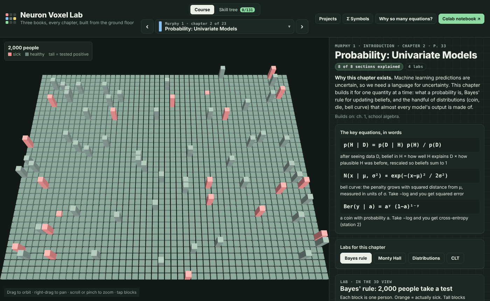
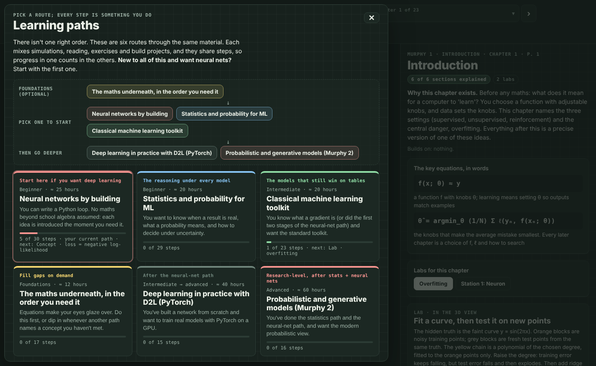
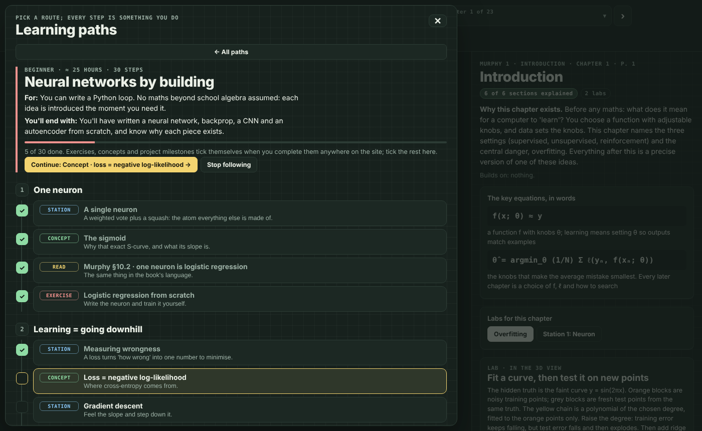
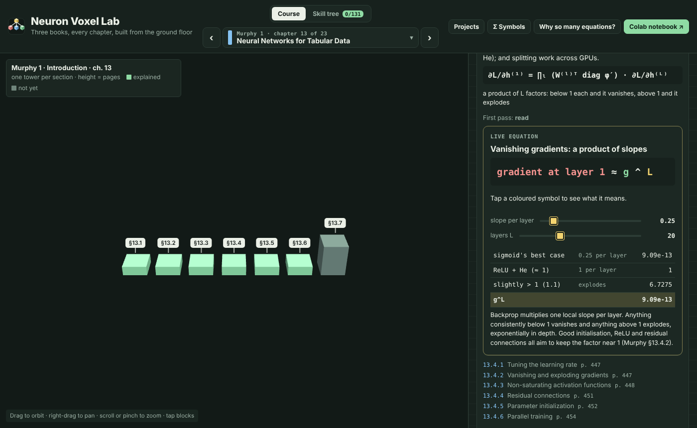
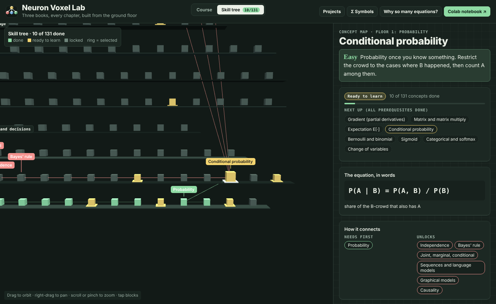
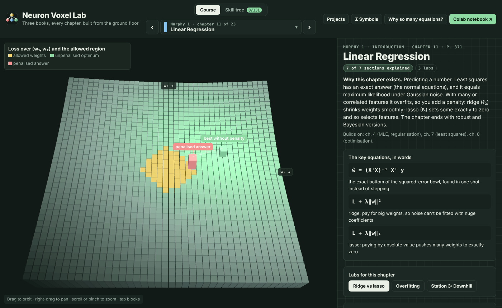
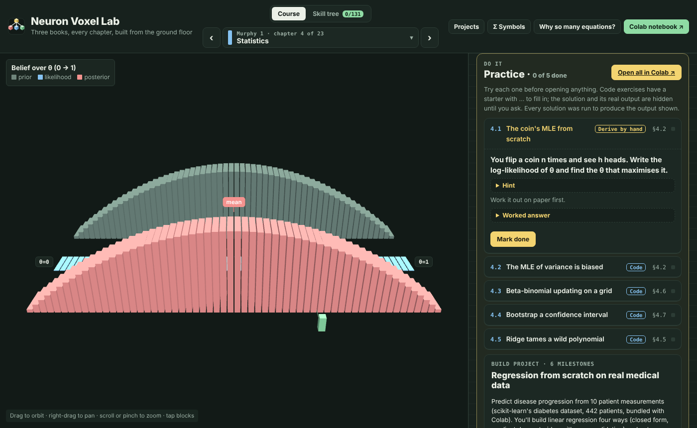
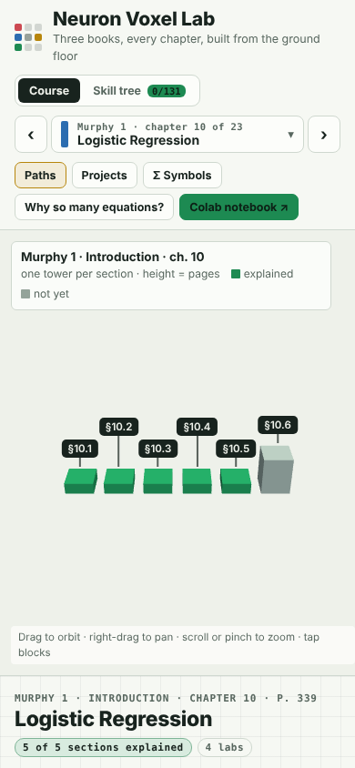
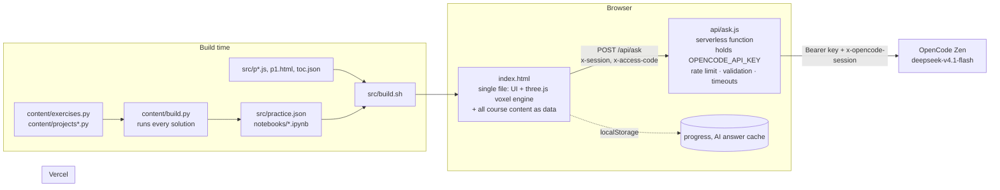

<div align="center">


# Neuron Voxel Lab

**Machine learning from first principles: three textbooks, every chapter, built up from a single neuron.**

[](https://neuron-voxel-lab.vercel.app)
[](https://colab.research.google.com/github/srivtx/neuron-voxel-lab/blob/main/notebooks/murphy1_ch01_practice.ipynb)




</div>

---

## Why this exists

ML textbooks are dense with equations, and most of them can feel like abstraction for its own sake. This site takes the opposite approach. Every idea starts from a concrete picture or a tiny numeric example. Every symbol is named the first time it appears. Every equation comes with a sentence saying *what it computes and why it has that shape*. You can then move the inputs and watch each term change, simulate the idea in 3D, and write it yourself in NumPy.

It covers:

| Book | Short name | Coverage |
|---|---|---|
| Kevin P. Murphy, *Probabilistic Machine Learning: An Introduction* (2022) | **Murphy 1** | Full table of contents; all 23 chapters explained section by section, with easy analogies, key equations, labs, live equations and exercises |
| Aston Zhang, Zachary C. Lipton, Mu Li, Alexander J. Smola, *Dive into Deep Learning* | **D2L** | Full table of contents; all 21 chapters explained section by section, with easy analogies, key equations, stations and live equations mapped to sections |
| Kevin P. Murphy, *Probabilistic Machine Learning: Advanced Topics* (2023) | **Murphy 2** | Full table of contents; all 36 chapters explained section by section, with easy analogies, key equations and concept map links |

Every one of the **2,660** chapters, sections and subsections is in the library, with page numbers. Each one also has an *Explain this simply* button and an ask box backed by an AI tutor.

## Where to start: learning paths

There isn't one right order through three textbooks, so the site offers **six learning paths**: ordered routes that mix 3D stations, labs, reading, exercises and build projects. Each one says who it's for and what you'll be able to do at the end. Paths share steps, so progress in one counts in the others. A floating pill always shows your next step, one click away.

<table>
<tr>
<td width="50%"></td>
<td width="50%"></td>
</tr>
</table>

```
Foundations (optional)   The maths underneath, in the order you need it
                                      │
Pick one to start        Neural networks by building ─ Statistics & probability ─ Classical ML toolkit
                                      │
Then go deeper           Deep learning in practice (D2L, PyTorch) ─ Probabilistic & generative models (Murphy 2)
```

| Path | For | Steps | You'll end with |
|---|---|---|---|
| **Neural networks by building** (start here for deep learning) | Anyone who can write a Python loop | 30 | A neural net, backprop, a CNN and an autoencoder, each written from scratch |
| **Statistics and probability for ML** | Anyone who wants to know when a result is real | 29 | An A/B test done six ways, a calibrated medical classifier, and a clear grasp of p-values vs posteriors |
| **Classical ML toolkit** | Those who know what a gradient is | 29 | Regression, classification, SVMs, trees, regularisation and clustering, each built once |
| **The maths underneath** | Anyone whose eyes glaze at equations | 17 | Σ, slopes, gradients, matrices, SVD and optimisation, each tied to a picture |
| **Deep learning with D2L** | Those who have built a net from scratch | 18 | Modern CNNs, RNNs, attention and transformers in PyTorch |
| **Probabilistic and generative** | Those who have done the stats and neural-net paths | 22 | Kalman filters, VI, MCMC, GPs, Bayesian DL, VAEs, flows, diffusion, RL and causality |

## Features

<table>
<tr>
<td width="50%"></td>
<td width="50%"></td>
</tr>
<tr>
<td><b>Live equations</b>: 45 interactive equations with sliders (mapped across 106 sections). Every term is computed and shown, and each coloured symbol says what it means when you tap it.</td>
<td><b>Skill tree</b>: 131 concepts on 11 floors, from Σ notation to diffusion, RL and causal inference. Every concept has a built-in check question to mark it done and unlock the ones that build on it.</td>
</tr>
<tr>
<td></td>
<td></td>
</tr>
<tr>
<td><b>Voxel labs</b>: 10 build-a-network stations and 23 chapter labs (three.js). Examples: Bayes' rule on 2,000 people, the CLT, bootstrap, ROC curves, SVD, LDA vs QDA, ridge vs lasso, k-means, multi-head attention, kernel SVM, decision trees, Kalman filtering, HMC/MCMC, diffusion (DDPM), actor-critic RL and causal do-calculus.</td>
<td><b>Practice</b>: 74 exercises across Murphy 1 (ch. 1–23), D2L and Murphy 2, in three kinds: <i>think</i>, <i>derive by hand</i> and <i>code</i>. Each has a hint, a hidden worked answer and a solution. Every solution is executed at build time, and the real output is shown.</td>
</tr>
</table>

- **Easy layer first.** Every explained section opens with a one-line plain-English version, then the precise one, plus worked numerical examples, NumPy/PyTorch snippets and subsection notes.
- **7 build projects** with milestones, questions, starter code and full solutions. Every number in an answer comes from running the solution:

  | # | Project | Track | What you build |
  |---|---|---|---|
  | 1 | Regression from scratch on real medical data | ML | Closed form → gradient descent → ridge + cross-validation → bootstrap error bars (diabetes data) |
  | 2 | Handwritten digits: PCA, softmax and optimisers | ML | PCA via SVD, softmax with hand-derived gradients, a gradient check, GD vs momentum vs Adam |
  | 3 | A neural network from scratch | NN | An MLP with backprop, weight decay and dropout; 98.5% test accuracy, beating the linear model |
  | 4 | Is the new version better? A/B testing from first principles | Stats | CLT error bars, bootstrap, permutation test, Bayesian posterior, power analysis, and why peeking pushes false positives from 5% to 24% |
  | 5 | Diagnose from measurements: generative vs discriminative | Stats | Naive Bayes, LDA and logistic regression on breast-cancer data; AUC, calibration, a 10:1 cost-weighted decision rule, learning curves |
  | 6 | Find groups without labels | ML | k-means and a full-covariance GMM fitted by EM; rediscover the iris species (purity 0.97); choose K with BIC |
  | 7 | A convolutional network from scratch | NN | im2col convolution, max-pool backward, a gradient check, CNN vs a same-size MLP, and a one-pixel-shift robustness test |

- **Colab notebooks**, one per practiced chapter plus one per project (40 in all). Solutions are hidden in collapsed cells, and they run on any Colab runtime (an L4 GPU is not required for the practice sets).
- **Symbols decoder**: the 54 symbols the books are written in, each with its name, meaning and an example.
- **"Why so many equations?"**: six equations that carry most of deep learning, each linked to the station where you can see it.
- **Custom-designed controls**: no native dropdowns or default form widgets anywhere; sliders, toggles, segmented buttons and pickers are all styled to the theme. Dark (chalk on slate) and light (graph paper) themes follow your OS.
- **Keyboard**:

  | Key | Action |
  |---|---|
  | <kbd>/</kbd> | Search the library |
  | <kbd>←</kbd> <kbd>→</kbd> | Previous / next chapter |
  | <kbd>c</kbd> | Course view |
  | <kbd>t</kbd> | Skill tree |
  | <kbd>l</kbd> | Learning paths |
  | <kbd>p</kbd> | Projects |
  | <kbd>s</kbd> | Symbols decoder |
  | <kbd>?</kbd> | Show all shortcuts |
  | <kbd>Esc</kbd> | Close |

- **Deep links**:
  - `#M10` opens Murphy 1, chapter 10;
  - `#D7` opens D2L chapter 7;
  - `#A21` opens Murphy 2, chapter 21;
  - `#c-backprop` opens a concept;
  - `#s5` opens a station.
- **Progress stays in your browser** (localStorage). There are no accounts and no tracking.
- **Works on phones**: the layout reflows, and the 3D view supports touch orbit and pinch zoom.

<p align="center"></p>

## Architecture



- **No framework, no bundler, no client-side dependencies to install.** The site is one static `index.html` (about 650 KB, mostly course text) plus three.js r128 from a CDN.
- **The API key never reaches the browser.** It lives only in a Vercel environment variable read by `api/ask.js`.
- **Content is data**: chapter intros (`CHI`), section explanations (`SEC`), the easy layer (`EASY`), live equations (`LIVE`), concepts (`CONCEPTS`) and checks (`CHECKS`). Adding a section's explanation means adding one object entry.

## Quick start

```bash
git clone https://github.com/srivtx/neuron-voxel-lab.git
cd neuron-voxel-lab

# Just look at it: open index.html in a browser (AI buttons need the API, see below)
python3 -m http.server 8000   # → http://localhost:8000

# Full local dev with the AI tutor
cp .env.example .env.local    # put your OpenCode key in it
npx vercel dev                # serves index.html + /api/ask on http://localhost:3000
```

## Deploy on Vercel

1. Import the repo at [vercel.com/new](https://vercel.com/new). There is no framework preset or build command to set: `index.html` is static, and `api/ask.js` becomes a serverless function automatically.
2. Add environment variables (**Settings → Environment Variables**):

   | Variable | Required | Default | What it does |
   |---|---|---|---|
   | `OPENCODE_API_KEY` | yes | none | Your OpenCode key. Server-side only. |
   | `OPENCODE_MODELS` | no | `zen:deepseek-v4.1-flash` | Comma-separated models to try in order. `zen:` = OpenCode Zen, billed from pay-as-you-go credits; no prefix = an OpenCode Go subscription. **Leave unset** unless you have a reason. |
   | `ACCESS_CODE` | recommended for public sites | none | A passphrase visitors type once before asking, so strangers can't spend your budget. |
   | `RATE_LIMIT_PER_MIN` | no | `12` | Questions per IP per minute (per warm instance). |
   | `RATE_LIMIT_PER_DAY` | no | `300` | Questions per IP per day (per warm instance). |

3. Make sure your OpenCode Zen account has credits. DeepSeek V4.1 Flash costs $0.30 per million input tokens and $1.20 per million output tokens, so a typical answer costs a fraction of a cent. If OpenCode asks for a region, allow **Global** under Settings → Privacy.
4. Redeploy, then open `/api/ask?diag=1` to confirm. It should list `zen:deepseek-v4.1-flash` under `working`.

`vercel.json` sets a strict Content-Security-Policy, `nosniff`, `Referrer-Policy`, `Permissions-Policy`, long caching for icons and `no-store` for the API, and gives the function 60 s.

## API reference

### `POST /api/ask`

Ask the tutor. The server adds the system prompt.

```http
POST /api/ask
Content-Type: application/json
x-session: nvl-k3j2h1g9f8      # optional, [\w-]{8,64}; keeps one OpenCode session per learner
x-access-code: …               # required only if ACCESS_CODE is set

{ "messages": [ { "role": "user", "content": "Why is the logistic loss convex?" } ] }
```

The request:
- may contain 1–24 messages;
- uses only the roles `user` and `assistant`;
- has at most 30,000 characters in total.

| Status | Body | Meaning |
|---|---|---|
| `200` | `{ "text": "…", "model": "deepseek-v4.1-flash" }` | Answer |
| `400` | `{ "error": "…" }` | Malformed messages |
| `401` | `{ "error": "Access code needed." }` | `ACCESS_CODE` set and header missing or wrong |
| `413` | `{ "error": "…" }` | Question too long |
| `429` | `{ "error": "…" }` + `Retry-After` | Rate limited |
| `500` | `{ "error": "…" }` | `OPENCODE_API_KEY` not set |
| `502` | `{ "error": "Every model failed: …", "tried": [ … ] }` | Upstream failure; the error lists each model, endpoint and status it tried |

Behaviour:
- Each model is tried against both OpenCode URL shapes. For Zen these are `/inference/openai/v1/chat/completions` and the older `/zen/v1/chat/completions`; for Go they are `/zen/go/v1/…` and `/inference/go/openai/v1/…`.
- The URL that answered is remembered while the function stays warm.
- An auth error (`401`/`403`) skips the remaining URLs for that model.
- The whole call is bounded to 55 s.

### `GET /api/ask?diag=1`

A health check. Add `&code=…` if `ACCESS_CODE` is set. It sends a 5-token ping to every configured model and endpoint, then reports what came back:

```json
{
  "keySet": true,
  "keyPrefix": "sk-abc…",
  "models": ["zen:deepseek-v4.1-flash"],
  "checks": [{ "model": "zen:deepseek-v4.1-flash", "endpoint": "/inference/openai/v1/chat/completions", "status": 200, "detail": "ok" }],
  "working": ["zen:deepseek-v4.1-flash via /inference/openai/v1/chat/completions"]
}
```

The key itself is never returned; only its first six characters are.

## Content pipeline

Exercises and projects are Python source files whose solutions are **executed**, so every answer on the site matches real output.

```bash
python3 content/build.py
# runs every exercise + project solution, captures stdout,
# writes src/practice.json and notebooks/murphy1_chNN_practice.ipynb, notebooks/project_pN.ipynb

bash src/build.sh          # or: npm run build:site
# concatenates src/ parts + practice.json + toc.json → index.html
```

- End a solution line with `## some hint` and the starter version replaces it with `# TODO: some hint`.
- Notebooks put each solution in a collapsed cell (`cellView: form`) and each worked answer in a `<details>` block, so you can try first.
- Colab links point to `notebooks/` on the `main` branch of this repo.

To add a section explanation, add an entry to the `SEC` / `EASY` objects. For example, in `src/p8.js`:

```js
Object.assign(SEC,  { "M15.2": { t: "Plain-English explanation…", eq: ["the equation", "what it computes"], sim: "s5" } });
Object.assign(EASY, { "M15.2": "One-line version." });
```

The key is the book letter (`M` = Murphy 1, `D` = D2L, `A` = Murphy 2) plus the section number from `src/toc.json`.

## Project structure

```
.
├── index.html               # generated: the whole site
├── api/ask.js               # serverless AI proxy (the only place the key exists)
├── vercel.json              # function timeout, security headers, caching
├── favicon.svg, *.png       # icons; og.png is the social preview (docs/logo.svg = README copy)
├── manifest.webmanifest
├── src/
│   ├── build.sh             # assembles index.html
│   ├── p1.html              # layout, design tokens (dark + light), panels
│   ├── p2.js                # voxel engine, label layout, tiny NN library, stations 1–10
│   ├── p4.js                # lab framework + Murphy 1 ch. 1–8 labs
│   ├── p5easy.js, p5.js     # easy layer, chapter intros, section text, chapter pages
│   ├── ch/*.js              # all 80 chapter files (M15–M23, D1–D21, A1–A36) with worked examples & code
│   ├── p6a.js               # concepts (131), floors, symbols (54)
│   ├── p6b.js               # live equations UI, AI client with streaming & normalizer, library, concept tower
│   ├── p7a.js               # concept check questions (all 131 concepts across floors 0–10)
│   ├── p7b.js               # skill-tree progression, practice + projects UI, ch. 9–21 & Murphy 2 3D labs
│   ├── p8.js                # Murphy 1 ch. 9–14 explanations + 45 live equations (106 section mappings)
│   ├── p9.js                # learning paths, path map, next-step pill
│   ├── p3.js                # station content, ask box, routing, app shell
│   ├── toc.json             # every section of all three books
│   └── practice.json        # generated by content/build.py
├── content/
│   ├── exercises.py         # 55 exercises for Murphy 1 ch. 1–14
│   ├── exercises_more.py    # 19 exercises for Murphy 1 ch. 15–23, D2L and Murphy 2
│   ├── projects.py          # projects 1–3
│   ├── projects_more.py     # projects 4–7 (stats, decisions, clustering, CNN)
│   └── build.py             # runs solutions → practice.json + notebooks
├── notebooks/               # 40 Colab notebooks (generated + the autoencoder notebook)
└── docs/screens/            # README screenshots
```

## Troubleshooting

| Symptom | Fix |
|---|---|
| Ask box says *Every model failed* | Open `/api/ask?diag=1`. The status code tells you what went wrong: `401` means the key wasn't accepted (check the variable name, and redeploy after adding it); `400 … x-opencode-session` means you are running an old `ask.js`; `402`/`403` means you are out of Zen credits or have a region/billing problem; `404` means the model name is wrong; `429` means you are rate limited. |
| AI works for a while, then fails | Look for an old `OPENCODE_MODELS` variable in Vercel that still lists free models. Delete it so the default `zen:deepseek-v4.1-flash` (Zen credits) is used. |
| *Access code needed* | You set `ACCESS_CODE`. Enter it in the ask box when prompted (it's stored in your browser). |
| 3D view is blank | WebGL is disabled or blocked. Try another browser, or enable hardware acceleration. |
| AI buttons do nothing inside a claude.ai preview | Expected: artifact previews block network calls. Use the deployed site. |
| Progress disappeared | Progress is per browser and is lost if you clear site data or use a private window. |

## Security

- The OpenCode key is only ever read from `process.env` on the server. `.env*` files are git-ignored (except `.env.example`).
- Input is validated (roles, counts, size). The per-IP rate limit and optional `ACCESS_CODE` protect your budget.
- The CSP only allows scripts from `self`, cdnjs and jsdelivr; styles and fonts from Google Fonts; and network calls to `self`.
- If a key is ever pasted somewhere public (a chat, an issue, a commit), **rotate it** in OpenCode.

## Roadmap

- [x] Section-by-section explanations for Murphy 1 ch. 15–23
- [x] Section-by-section explanations for D2L and Murphy 2 (all 80 chapters & 490 non-exercise sections explained with easy analogies, worked examples, code snippets and live equations)
- [x] Learning paths, with stats, decision and clustering projects and a CNN from scratch
- [x] Exercises for later chapters (Murphy 1 ch. 15–23, D2L and Murphy 2), and 8 new 3D labs (attention, SVM, trees, Kalman, MCMC, diffusion, RL, causality)
- [x] Check questions for all 131 concepts across floors 0–10

## Contributing

Issues and pull requests are welcome. Keep the house style:
- concrete example first;
- name every symbol;
- say what each equation computes and why it has that shape;
- plain characters, not LaTeX.

For practice content, run `python3 content/build.py` so the answers match real outputs. Then run `bash src/build.sh` and check the page in a browser before opening a PR.

## Credits

- Built by **[Sribatsha Dash (@srivtx)](https://github.com/srivtx)**.
- The course follows the structure of three excellent books, all freely available from their authors:
  - Kevin P. Murphy, [*Probabilistic Machine Learning: An Introduction*](https://probml.github.io/pml-book/book1.html), MIT Press, 2022;
  - Kevin P. Murphy, [*Probabilistic Machine Learning: Advanced Topics*](https://probml.github.io/pml-book/book2.html), MIT Press, 2023;
  - Aston Zhang, Zachary C. Lipton, Mu Li, Alexander J. Smola, [*Dive into Deep Learning*](https://d2l.ai), Cambridge University Press, 2023.
- The explanations, simulations and exercises here are original. The section titles and page numbers point back to the books. This project is **not affiliated with or endorsed by** the authors or publishers; please read and cite the books themselves.
- 3D rendering by [three.js](https://threejs.org). AI answers by DeepSeek V4.1 Flash via [OpenCode](https://opencode.ai).

## License

No license has been chosen yet, so all rights are reserved by the author for now. If you'd like to reuse something, open an issue.
